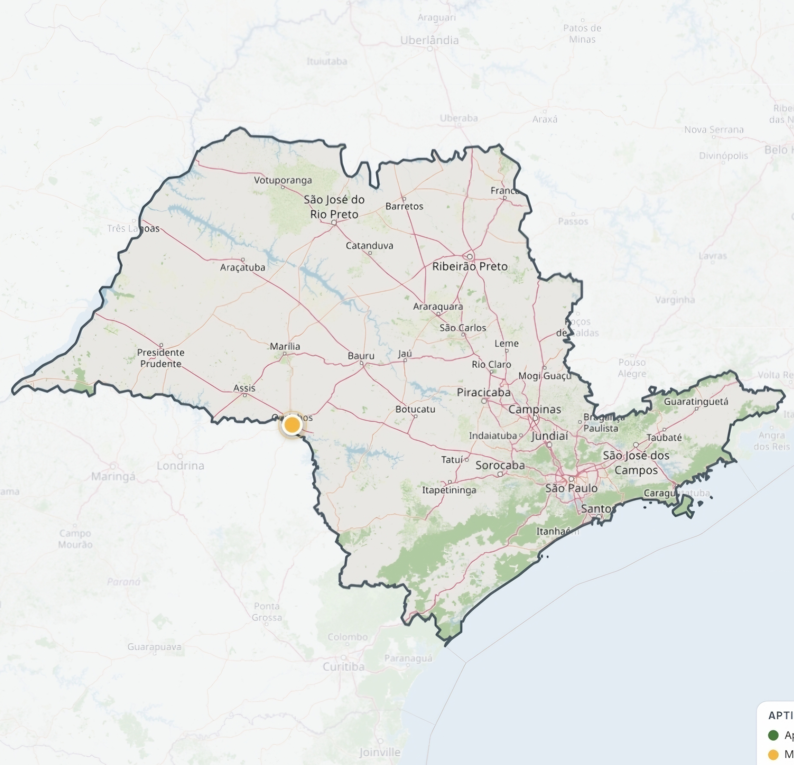
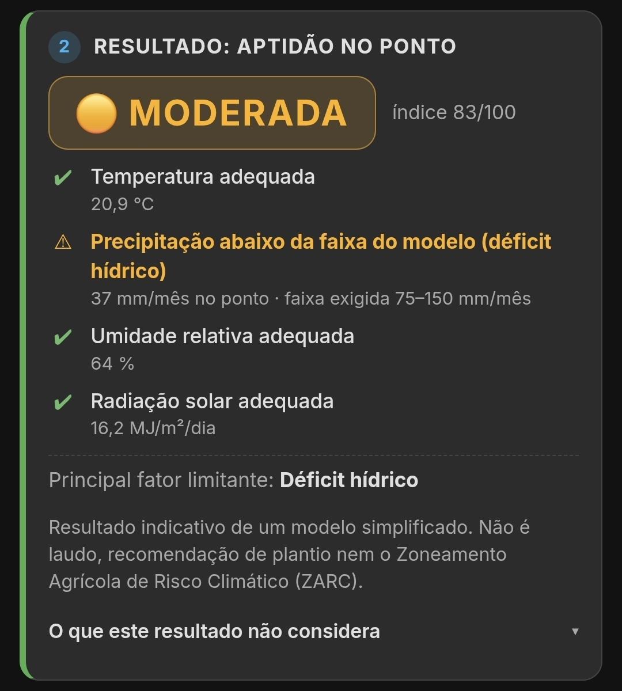
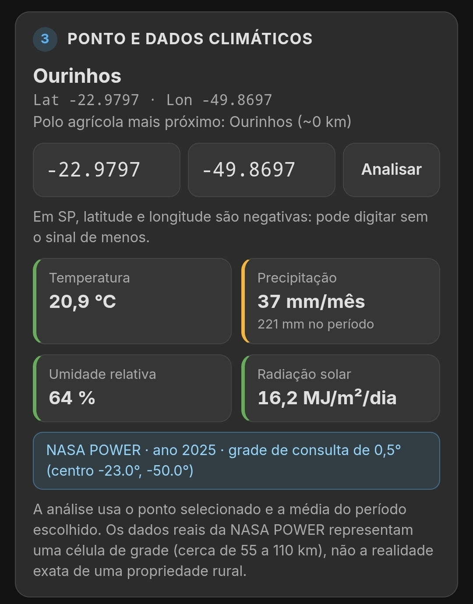

<!-- Apresentação do projeto -->
<div align="center">

# 🌱 Mapa de Aptidão Agrícola — São Paulo

**Uma ferramenta web para explorar a compatibilidade climática de culturas agrícolas no estado de São Paulo.**

[🌐 Acessar o sistema](https://mapadeaptidao.netlify.app) · [📖 Metodologia e fontes](metodologia.md) · [🧪 Testes](tests/run.js)


</div>

---

## Sobre o projeto

O **Mapa de Aptidão Agrícola** é um projeto desenvolvido para o **Projeto Integrador da Fatec Bebedouro**, no curso de Big Data no Agronegócio.

A aplicação permite selecionar pontos no estado de São Paulo e consultar uma estimativa indicativa de compatibilidade climática para cinco culturas:

- Cana-de-açúcar
- Milho
- Soja
- Laranja
- Amendoim

O resultado é apresentado em três classes: **Apta**, **Moderada** e **Inapta**. A proposta é reunir dados climáticos e recursos de visualização em uma interface interativa.

> **Importante:** as classificações são estimativas de um modelo simplificado. Não representam laudo oficial de aptidão agrícola, recomendação de plantio ou o Zoneamento Agrícola de Risco Climático (ZARC). Consulte [Metodologia, fontes e limitações](metodologia.md) para conhecer os critérios e as restrições do modelo.

## Exemplo de análise

A seguir, um exemplo de consulta realizada para **laranja (*Citrus sinensis*) em Ourinhos, SP**, considerando o período de **safrinha/inverno (abril a setembro)**.

### 1. Localização no mapa

O ponto selecionado em Ourinhos é apresentado no mapa interativo.



### 2. Resultado da análise

A consulta apresentou classificação **MODERADA**, com pontuação de **83/100**. O principal fator limitante identificado foi o déficit hídrico.



### 3. Dados climáticos

A análise utilizou dados da **NASA POWER**, referentes ao ano de 2025, em uma grade de resolução de 0,5°, com centro de célula em aproximadamente **-23,0°, -50,0°**.

A precipitação média indicada foi de **37 mm/mês**, abaixo da faixa de referência de **75 a 150 mm/mês** adotada pelo modelo para a cultura.



**Como interpretar:** o resultado indica compatibilidade climática parcial segundo os critérios simplificados da aplicação. Nenhuma variável crítica ultrapassou os limites de tolerância definidos, mas a disponibilidade de água aparece como o principal ponto de atenção.

> **Limitações deste exemplo:** trata-se de uma análise demonstrativa, não de um relatório técnico ou recomendação de plantio. O modelo utiliza tolerâncias e pesos simplificados, com base técnica parcial e sem validação científica. Não considera fatores como solo, relevo, cultivar, fases da cultura, distribuição da chuva ao longo do ciclo ou eventos extremos. O balanço hídrico também é simplificado. Além disso, os dados da NASA POWER representam uma célula de grade com escala espacial aproximada de dezenas de quilômetros — não as condições exatas de uma propriedade rural. A classificação não é oficial e não substitui o ZARC.

## Recursos

- **Mapa interativo:** exploração de localidades dentro do estado de São Paulo.
- **Consulta climática:** obtenção de dados pela API NASA POWER, com alternativa de simulação local.
- **Cinco culturas agrícolas:** comparação indicativa de compatibilidade climática.
- **Visualização regional:** grade para explorar padrões espaciais.
- **Gráficos e relatório:** apresentação dos resultados da consulta.
- **Simulador climático:** ajuste de variáveis para observar como cenários simulados afetam a classificação.
- **Tema claro e escuro:** opção de aparência pela interface.

## Dados e funcionamento

A aplicação consulta a API **NASA POWER**, utilizando variáveis meteorológicas como:

| Variável | Descrição |
|---|---|
| `T2M` | Temperatura do ar a 2 metros |
| `PRECTOTCORR` | Precipitação total corrigida |
| `RH2M` | Umidade relativa do ar a 2 metros |
| `ALLSKY_SFC_SW_DWN` | Radiação solar de superfície em céu real |

Os dados representam médias de células de grade, não medições exatas no ponto selecionado. A resolução espacial e o período disponível variam conforme a variável e a fonte.

A classificação compara os dados climáticos com faixas e tolerâncias definidas no projeto. Parte dos parâmetros tem apoio técnico parcial; outros são ilustrativos e ainda não foram validados cientificamente.

O modelo não considera, entre outros fatores, as características físicas e químicas do solo, declividade, cultivar, fases de desenvolvimento, distribuição da chuva durante o ciclo e eventos extremos.

A descrição completa está em [metodologia.md](metodologia.md).

## Tecnologias utilizadas

- **HTML5** — estrutura da aplicação.
- **CSS3** — identidade visual, responsividade e temas.
- **JavaScript** — lógica, consultas, cálculos e interações.
- **Leaflet** — mapa interativo.
- **Chart.js** — gráficos.
- **OpenStreetMap** — mapa-base.
- **NASA POWER API** — dados meteorológicos.

O projeto utiliza JavaScript sem framework e não exige etapa de build.

## Estrutura do repositório

```text
mapadeaptidao/
├── css/
│   └── style.css
├── docs/
│   └── screenshots/
│       ├── 01-mapa-ourinhos.png.jpg
│       ├── 02-resultado-laranja.png.jpg
│       └── 03-dados-climaticos.png.jpg
├── js/
│   ├── agronomia.js
│   ├── app.js
│   ├── clima.js
│   ├── culturas.js
│   ├── geo.js
│   ├── grade-regional.js
│   ├── graficos.js
│   ├── limites-sp.js
│   ├── mapa.js
│   ├── municipio.js
│   ├── nasa-power.js
│   ├── polos.js
│   ├── relatorio.js
│   ├── simulador.js
│   ├── tema.js
│   └── util.js
├── tests/
│   └── run.js
├── index.html
├── metodologia.md
├── netlify.toml
└── readme.md
```

## Executar localmente

É necessário ter Python 3 ou outro servidor HTTP simples. A aplicação depende de recursos externos, como Leaflet, Chart.js, OpenStreetMap e NASA POWER.

1. Faça o download ou clone este repositório.
2. Abra um terminal na pasta do projeto.
3. Inicie um servidor local:

```bash
python3 -m http.server 8000
```

4. Acesse [http://localhost:8000](http://localhost:8000).

> Abrir o arquivo HTML diretamente pelo navegador (`file://`) pode impedir o carregamento de recursos do mapa. Por isso, utilize um servidor local.

## Testes

Os testes automatizados podem ser executados com **Node.js 18 ou superior**, sem instalar dependências:

```bash
node tests/run.js
```

A suíte verifica partes do motor agronômico, cálculos, interpretação de dados da NASA POWER e tratamento de requisições. São utilizados dados sintéticos; os testes não consultam a API real e não cobrem todos os textos e elementos da interface.

## Documentação

- [Metodologia, fontes e limitações](metodologia.md) — detalhamento dos dados, critérios, cálculos, referências e limitações científicas.
- [Código dos testes](tests/run.js) — verificações automatizadas do projeto.

---

<div align="center">

**Projeto Integrador · Fatec Bebedouro · Big Data no Agronegócio**

</div>
